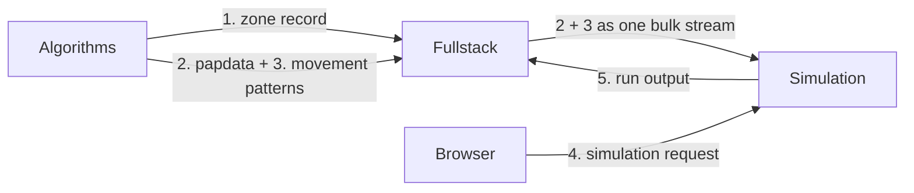

# Deep dive: data passed between services

Five kinds of data cross the boundaries between Delineo's services. Each one
is a **contract**: at least two repos depend on its exact shape, and the
repos deploy separately. This page describes the shape of each one today,
where it's defined, and how to change it safely.

Read [Start Here](START_HERE.md) first for the big picture.

## The rule for changing any of these

**Update the readers first, then the writer.** Make every consumer accept both
the old and new shapes, deploy that, and only then change the producer. Each
repo deploys on its own merge to `main`, so for a while production always runs
a new version of one service next to an old version of another. See
[How We Work](HOW_WE_WORK.md#changes-that-touch-more-than-one-repo).

## Overview



| # | Data | Producer | Stored by Fullstack as | Consumers | Shape defined in |
| --- | --- | --- | --- | --- | --- |
| 1 | Zone record | Algorithms | `ConvenienceZone` row | Fullstack UI | `createConvenienceZoneSchema` in `Fullstack/src/server/services/convenience-zones.ts` |
| 2 | papdata (the population) | Algorithms | `<papdata_id>.gz` | Simulation, Fullstack UI | `convert_data` in `Algorithms/server/papdata_convert.py` |
| 3 | Movement patterns (input) | Algorithms | `<patterns_id>.bin` or `.gz` | Simulation | both copies of `patterns_codec.py` |
| 4 | Simulation request | Browser | not stored | Simulation | `simulation_schema` in `Simulation/server.py` |
| 5 | Run output | Simulation | `<file_id>.sim.gz`, `<file_id>.pat.gz`, `SimData` row | Fullstack UI | `Simulation/simulator/snapshots.py`, `runner.py` |

All files live in Fullstack's `DB_FOLDER`. Postgres stores only their IDs.

---

## 1. Zone record

When a zone is finalized, Algorithms calls `POST /api/convenience-zones` with
JSON:

```json
{
  "name": "Hagerstown, MD",
  "description": "...",
  "latitude": 39.64,
  "longitude": -77.72,
  "cbg_list": ["240430001001", "240430001002"],
  "start_date": "2021-04-01T00:00:00Z",
  "length": 168,
  "size": 5120,
  "user_id": "…",
  "guest_claim_token": null
}
```

- `length` is in **hours**. `size` is the total population of the CBGs.
- `cbg_list` holds 12-character GEOID strings.
- The response is `{"data": {"id": <czone_id>, ...}}`. Algorithms uses that ID
  for everything that follows.
- The zone isn't usable until papdata and patterns are uploaded (section 2).
  Until then, its `papdata_id` and `patterns_id` are null. Fullstack reports
  `ready: false` and broadcasts a `zone-ready` event once the upload lands.

## 2. papdata: the synthetic population

Algorithms builds it in `papdata_convert.convert_data`. It's one JSON object
with three ID spaces, `people`, `homes`, and `places`, plus two summary
blocks:

```json
{
  "people": {
    "0": {
      "sex": 0, "age": 34, "home": "12", "home_cbg": "240430001001",
      "is_worker": true, "work_location_type": "poi", "work_poi": "57", "work_p_inside": 0.82,
      "is_student": false, "school_location_type": "none", "school_poi": null
    }
  },
  "homes": {
    "12": { "cbg": "240430001001", "members": 3, "latitude": 39.64, "longitude": -77.71 }
  },
  "places": {
    "57": {
      "placekey": "zzw-222@...", "label": "Example Grocery", "cbg": "240430001002",
      "latitude": 39.65, "longitude": -77.72, "top_category": "Grocery Stores",
      "street_address": "...", "postal_code": "21740", "naics_code": "445110",
      "footprint": { "type": "Polygon", "coordinates": [] },
      "area": 1830.0, "catchment_fj": 0.14
    }
  },
  "worker_assignment": { "version": "v1_area_weighted_in_zone_only", "...": "..." },
  "school_assignment": { "version": "v1_school_area_weighted", "...": "..." }
}
```

Field notes:

- **IDs are strings of integers, and each space is separate.** Home `"12"` and
  place `"12"` are different things. Code that mixes homes and places (like the
  binary patterns format) always lists homes first, then places.
- **`sex`**: `0` is male and `1` is female.
- **`home`** is a home ID. **`work_poi`** and **`school_poi`** are place IDs.
- **Workers** are adults chosen with an age-based employment probability (65%
  for ages 18-64 and 10% for 65 and older by default). Each worker is assigned
  one in-zone place, weighted by floor area. `work_p_inside` is kept for
  diagnostics only; it no longer sends anyone out of the zone.
- **Students** are ages 5-17. Each is assigned an in-zone school, weighted by
  area. If the zone has no schools, students get `school_location_type:
  "out_of_zone"`, and a synthetic place with `"external_location_type":
  "out_of_zone_school"` is added to `places`. It has no coordinates.
- **Homes** only have `latitude` and `longitude` when residential placement
  succeeded.
- **`area`** is floor area in m². If SafeGraph has no area for a place, it falls
  back to the median for the place's category, then the overall median.
  Simulation uses it for area-aware ventilation.
- **`catchment_fj`** is the share of a place's real visitors who live inside
  the zone. It's never lower than 0.02, because the simulator's
  external-infection term divides by it.
- **`footprint`** is the building outline as GeoJSON, or `null`.

Fullstack gzips papdata and stores it as `<papdata_id>.gz`.

## 3. Movement patterns (the input to a simulation)

The movement schedule is a **complete snapshot at every timestep**: every
person is at exactly one location at every hour. Timestep keys are minutes
from the start: `60`, `120`, `180`, and so on.

There are two encodings. Fullstack accepts both, and Simulation reads both.

### Binary: DLNOPAT1 (the default)

Algorithms sends this unless `DELINEO_PATTERNS_BINARY=0`. It stores the
schedule as a dense matrix, `M[timestep, person] = location index`. It's about
15 times smaller than the JSON and decodes in under a second.

The full byte layout is documented at the top of `patterns_codec.py`. In
summary:

| Part | Contents |
| --- | --- |
| Header | Magic bytes `DLNOPAT1`, the layout, the matrix dtype (uint16 or uint32), the codec (zstd, gzip, or none), and the counts `T` (timesteps), `N` (people), `L` (locations), `n_homes` |
| `ts_minutes` | The timestep keys |
| ID tables | Person IDs (matrix column to person) and location IDs (index to location, homes first) |
| Payload | The compressed `T × N` matrix |
| Optional `MINS` section | A `T × N` uint8 matrix: minutes (1-60) each person actually spends at their location that hour. This is how fractional dwell is encoded. |

Two design points matter when you change it:

- **The ID tables travel inside the file.** The producer and consumer don't
  need to agree on an integer numbering; the consumer re-maps through the
  string IDs.
- **Older readers ignore new optional sections.** A reader stops after the
  payload and skips any section tag it doesn't know. That's how `MINS` was
  added without breaking anything. New optional data should be added the same
  way.

**There are two copies of the codec:** `Algorithms/server/patterns_codec.py`
(encoder) and `Simulation/simulator/patterns_codec.py` (decoder). They must stay
byte-compatible. Change both in the same pair of PRs, and keep the Simulation
reader deployed first. `Simulation/scripts/transcode_patterns.py` converts old
JSON patterns to binary.

### Legacy JSON

```json
{
  "60":  { "homes": { "12": ["0", "1"] }, "places": { "57": ["3"] }, "minutes": { "3": 30 } },
  "120": { "homes": { "12": ["0", "1", "3"] }, "places": {} }
}
```

Each timestep maps location IDs to the people there. The optional `minutes` map
lists partial-hour visits; anyone not in it spends the full hour.

### How Fullstack stores it

`POST /api/patterns` is a multipart form with `czone_id`, `papdata`, and
`patterns`. Fullstack checks the first 8 bytes of `patterns`. If they're
`DLNOPAT`, it stores the file unchanged as `<patterns_id>.bin`, since it's
already compressed. Otherwise it gzips it as `<patterns_id>.gz`.

### The bulk download Simulation reads

`GET /api/patterns/<czone_id>` returns both files in one response:

```text
<papdata as one line of JSON>\n<patterns body: binary bytes or JSON>\n
```

Simulation's `StreamDataLoader.load_bulk` (`simulator/data_interface.py`) splits
at the **first newline**, parses the papdata, and then checks the rest for the
`DLNOPAT` magic bytes. So papdata must never contain a raw newline;
`JSON.stringify` guarantees that. The response is labeled `text/plain` even when
the body is binary.

## 4. Simulation request

The browser sends this straight to Simulation's `POST /simulation/`. The full
field list is in the
[Simulation README](https://github.com/Delineo-Disease-Modeling/Simulation#the-simulation-request),
and `Fullstack/src/lib/simulation-request.ts` builds it.

Its `length` is in **minutes** (`hours * 60`), unlike the zone's `length`.

## 5. Run output

When a run finishes, Simulation calls `POST /api/simdata` with a multipart
form:

| Part | Contents |
| --- | --- |
| `czone_id` | The zone |
| `length` | Run length in minutes |
| `metadata` | JSON string with the run's settings and diagnostics (below) |
| `simdata` | `simdata.json.gz`: infection states over time |
| `patterns` | `patterns.json.gz`: where people were over time |

Fullstack creates the `SimData` row, saves the files as `<file_id>.sim.gz` and
`<file_id>.pat.gz`, and replies `{"data": {"id": <run_id>}}`. Simulation passes
that ID to the browser. Fullstack then post-processes the run in the background
(`src/lib/sim-processor.ts`). That writes `<file_id>.map.json` and stores
summary statistics in `SimData.global_stats`, or `{"error": ...}` if
processing fails. Other derived files, such as `<file_id>.dots.json`, are built
later as the results pages ask for them.

### `simdata.json`: infection states

```json
{
  "60":  { "Delta": { "4": 3, "9": 1 } },
  "120": { "Delta": { "4": 3, "9": 3, "17": 1 } }
}
```

For each timestep and variant, it maps a person ID to that person's
**infection state bits**. Everyone ever infected stays in the map, so recovered
people remain with the recovered bit set. Anyone not listed is susceptible.
The bits are `InfectionState` in `Simulation/simulator/pap.py`:

| Bit | State |
| --- | --- |
| 1 | Infected |
| 2 | Infectious |
| 4 | Symptomatic |
| 8 | Hospitalized |
| 16 | Recovered |
| 32 | Removed (deceased) |

They combine. A person's value includes every state whose time window (from
their DMP timeline) covers the current timestep. For example, `3` means infected
and infectious at once (1 + 2).

### `patterns.json`: where people were

The default engine writes compact numbers instead of lists of people:

```json
{
  "meta": { "pids": ["0", "1"], "loc_ids": ["12", "57"], "n_homes": 1 },
  "60": {
    "h": [3, 0],
    "p": [1, 1],
    "loc": [0, 0, 1],
    "pdots": [[1, 0]],
    "hinc": 0,
    "pinc": [1]
  }
}
```

- `meta` (written once): decode tables. `loc` values index `loc_ids`, homes
  first, and `n_homes` is where places begin.
- `h`, `p`: for each home and each place, in order, the pair `count, infected`,
  flattened into one array.
- `loc`: each person's location index, in `meta.pids` order.
- `pdots`: `[infected, recovered]` for each place, for the results map.
- `hinc`, `pinc`: running totals of infections that happened at home, and at
  each place.

The older engine writes the legacy `{"homes": {...}, "places": {...}}` shape
from section 3 instead. Fullstack's processor handles both.

### `metadata`

It records how the run was configured, so results can be interpreted later: the
disease and variants, `dmp_mode`, the feature flags in effect, the initial
infections, the random seed behavior, the interventions, and diagnostics:

- **`timeline_source_counts`**: how many infections got their disease timeline
  from the DMP, and how many fell back to a simpler built-in timeline. **The
  fallback has no hospitalizations or deaths**, so a run with fallbacks
  isn't fit for validation. Use `dmp_mode: "required"` to make a DMP miss an
  error instead.
- **`movement_intervention_redirects`**: how many person-hours each
  intervention sent home, which shows whether lockdown or isolation actually
  changed anything.

Fullstack stores `metadata` inside `SimData.global_stats`.

---

## Things to know before you touch these routes

- **Large payloads.** papdata and patterns for a big zone can be hundreds of
  megabytes as JSON. That's why the binary format exists, and why Fullstack
  streams files instead of loading them into memory. Keep it that way.
- **Test with a real zone end to end.** Unit tests in one repo can't catch a
  format mismatch with another repo. After changing a format, create a zone and
  run a simulation locally with all four services.
