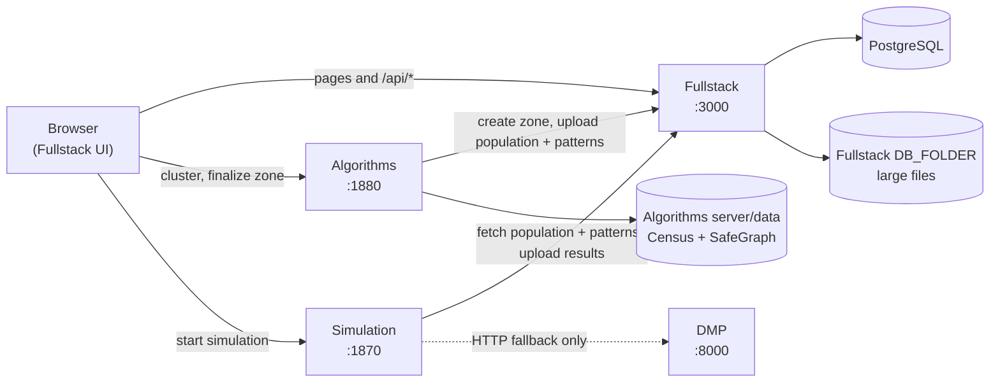

# Start Here

Welcome to Delineo. This page is the map: what the project does, how the four
repositories fit together, and what to read next. It should take about 20
minutes to read.

## What Delineo does

Delineo is a research platform for modeling how an infectious disease spreads
through a small community, hour by hour and person by person. The production
site is <https://covidmod.isi.jhu.edu>.

A run has four steps:

1. **Pick a place.** A user chooses a location on a map. Algorithms groups the
   nearby census block groups (CBGs) into a **convenience zone**: a region where
   most residents' day-to-day movement stays inside the region.
2. **Build the people.** Algorithms builds a synthetic population for that zone
   (people, households, and the places they visit) from Census data, then
   generates hour-by-hour movement for every person from SafeGraph foot-traffic
   data.
3. **Run the disease.** Simulation seeds some infections and steps through time.
   Each hour it works out who is in the same place, who infects whom (a
   Wells-Riley airborne transmission model), and how each infected person
   progresses through disease states (the DMP).
4. **Look at the results.** Fullstack is the website. It stores zones and runs,
   and shows the results as maps, charts, and per-person timelines.

If any of those terms are new, keep the [Glossary](GLOSSARY.md) open beside
this page.

## The four repositories

All four live in the
[Delineo-Disease-Modeling](https://github.com/Delineo-Disease-Modeling) GitHub
organization and are cloned side by side in one folder.

> **Deploy is private.** You can read these docs and clone Fullstack,
> Algorithms, and Simulation right away. To clone Deploy, which you need to run
> everything locally, you must be a member of the org. Send your GitHub username
> to the project lead to be added.

| Repo | What it is | Stack | Local port |
| --- | --- | --- | --- |
| [Fullstack](https://github.com/Delineo-Disease-Modeling/Fullstack) | The website: UI, accounts, API routes, and storage for zones and runs | Next.js, TypeScript, Prisma, PostgreSQL | 3000 |
| [Algorithms](https://github.com/Delineo-Disease-Modeling/Algorithms) | Zone clustering, synthetic population, movement patterns | Python, Flask | 1880 |
| [Simulation](https://github.com/Delineo-Disease-Modeling/Simulation) | The disease simulator, plus the DMP service | Python, Flask, FastAPI | 1870 (sim), 8000 (DMP) |
| [Deploy](https://github.com/Delineo-Disease-Modeling/Deploy) (private) | Scripts that run all of the above, locally and in production | Bash, Docker Compose | - |

Your folder should look like this:

```text
delineo/
├── Algorithms/
├── Deploy/
├── Fullstack/
└── Simulation/
```

## How the pieces talk to each other



Three things to notice:

- **The browser calls Algorithms and Simulation directly.** Their URLs are
  baked into the Fullstack build as `NEXT_PUBLIC_ALG_URL` and
  `NEXT_PUBLIC_SIM_URL`. Those services allow cross-origin requests from the
  site, which is why each one has a CORS origin list.
- **Fullstack is the only service that stores anything.** Algorithms and
  Simulation hand their output to Fullstack over HTTP; they never write to
  the database.
- **The DMP usually runs inside the simulator.** Simulation imports the DMP
  code directly. The separate DMP service on port 8000 is a fallback, and also
  a standalone API for other uses.

## End to end: creating a zone

This happens on the **CZ Generator** page (`/cz-generation`).

1. The user types an address, ZIP code, or coordinates. Fullstack's
   `/api/lookup-location` route turns it into a seed CBG, using OpenStreetMap's
   geocoder and Algorithms' `GET /seed-region`.
2. The browser asks Algorithms to cluster: `POST /cluster-cbgs` starts a job,
   and the page follows its progress on `GET /clustering-progress/<id>`, a
   Server-Sent Events stream. The user sees a preview of the zone and can add
   or remove CBGs.
3. When the user accepts, the browser calls Algorithms `POST /finalize-cz`.
4. Algorithms calls Fullstack `POST /api/convenience-zones` to create the zone
   row in Postgres, and replies right away with the new zone ID.
5. In a background thread, Algorithms then:
   - loads the SafeGraph patterns for that state and month,
   - builds the synthetic population (`popgen.py`; the output is called
     **papdata**),
   - generates the movement patterns (`patterns.py`),
   - uploads both to Fullstack `POST /api/patterns`. Fullstack saves them as
     files under its `DB_FOLDER` and records their IDs on the zone row.
6. The page shows progress from `GET /generation-progress/<czone_id>`, another
   event stream.

## End to end: running a simulation

This happens on the **Simulator** page (`/simulator`).

1. The user picks a zone, a disease model, and interventions (masks, vaccines,
   capacity limits, lockdown, self-isolation). The browser sends them to
   Simulation `POST /simulation/`.
2. Simulation downloads the zone's population and patterns from Fullstack
   `GET /api/patterns/<czone_id>`.
3. It runs the simulation (`simulator/simulate.py` and `simulator/runner.py`).
   When someone is infected, the DMP picks their path through disease states.
4. It uploads the results to Fullstack `POST /api/simdata`, which stores the
   files and creates a run row.
5. Throughout, Simulation streams progress back to the browser as
   Server-Sent Events. The last message carries the new run ID, and the browser
   opens `/simulator/<run_id>` to show the results.

## Where the data lives

| What | Where | In git? |
| --- | --- | --- |
| Users, sessions, zone and run metadata, DMP matrices | PostgreSQL (schema in `Fullstack/prisma/schema.prisma`) | Schema and migrations only |
| Population, movement patterns, simulation output, map caches | Files under Fullstack's `DB_FOLDER` (default `Fullstack/db/`) | No |
| Input datasets: SafeGraph patterns, TIGER shapefiles, Census tables | `Algorithms/server/data/` | No, it is too large. See [Setup](SETUP.md#3-get-the-algorithms-data) |

## Your first week

1. Read this page and the [Glossary](GLOSSARY.md).
2. Get the whole stack running on your machine: [Setup](SETUP.md).
3. Create a small zone and run a simulation on it locally. Then find the zone
   and the run in Postgres and in `Fullstack/db/`.
4. Read the README of the repo your team works in, then the deeper docs it
   links to.
5. Read [How We Work](HOW_WE_WORK.md) before you open your first pull request.
   In particular: **every merge to `main` deploys to production.**

## Where to go next

- [Setup](SETUP.md): running everything locally, with or without Docker
- [Glossary](GLOSSARY.md): the vocabulary used across all four repos
- [How We Work](HOW_WE_WORK.md): branches, pull requests, testing, deploys, and
  AI coding tools
- Repo READMEs: [Fullstack](https://github.com/Delineo-Disease-Modeling/Fullstack#readme),
  [Algorithms](https://github.com/Delineo-Disease-Modeling/Algorithms#readme),
  [Simulation](https://github.com/Delineo-Disease-Modeling/Simulation#readme)

### Deep dives

Read these once you're comfortable with the basics, starting with the ones for
your team:

| Deep dive | What it covers | Most useful for |
| --- | --- | --- |
| [Data formats](DATA_FORMATS.md) | The exact data passed between services, and how to change it safely | Everyone |
| [Model assumptions](MODEL_ASSUMPTIONS.md) | What the model assumes, what's calibrated, and what results can claim | Everyone, before presenting results |
| [Clustering](https://github.com/Delineo-Disease-Modeling/Algorithms/blob/main/docs/CLUSTERING.md) | How zones are built, and every clustering algorithm | Algorithms |
| [Population and movement](https://github.com/Delineo-Disease-Modeling/Algorithms/blob/main/docs/POPULATION_AND_MOVEMENT.md) | How the synthetic population and hourly movement are generated | Algorithms, Simulation |
| [Simulation engine](https://github.com/Delineo-Disease-Modeling/Simulation/blob/main/docs/SIMULATION_ENGINE.md) | The engine loop, Wells-Riley transmission, interventions, and the DMP | Simulation |

## Who to ask

> **TODO:** add the current project lead, the lead for each team, and where the
> team talks (Slack/Discord channel, meeting times).
